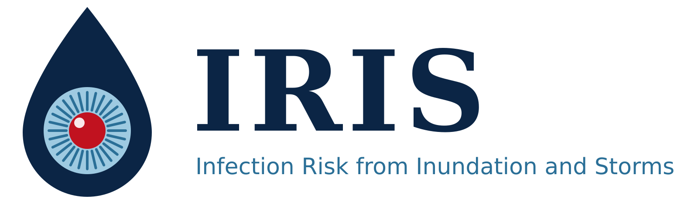

# IRIS: Infection Risk from Inundation and Storms

An entry for the Philippine Junior Data Science Challenge (PJDSC) 2026.

## Background

Every time Metro Manila floods, leptospirosis cases follow. After Ondoy in 2009 there were 2,089 cases and 162
deaths. After Carina in July 2024, DOH hospitals took in 523 cases in just six days, and NKTI had to turn its gym
into a ward. The cases do not come right away. They come two to three weeks after the flood, and doxycycline can
prevent infection if taken within 72 hours of wading, so there is time to act.

The information, however, is scattered. UP NOAH maps where floods go, and DOH counts cases after they happen, but
nothing tells a city health office which barangays to prepare, or when. IRIS fills that gap by joining open
rainfall, flood hazard, census and disease data into one dashboard.

## What the dashboard does

There are two versions. The main one is the Metro Manila version (`app/metro_manila.py`), which works at the
barangay level. The national version (`app/app.py`) came first and works at the province level.

The Metro Manila version has five tabs:

1. **Rainfall alert.** Choose a 10-day rainfall period. If Metro Manila's rain is above its 90th percentile
   (166 mm), the app raises an alert and gives three dates: when hospitals should be ready for cases, when cases
   are expected to peak, and when the alert can end. These dates are for the case surge. Doxycycline has to be in
   the barangays *before* the flood, since it only works if taken within 24 to 72 hours of wading (or weekly while
   people stay in flooded areas); the Outlook tab supports that earlier step.
2. **Outlook.** A 16-day rain forecast from Open-Meteo, a slider to plan for any amount of rain (which barangays
   are likely to flood, and how many young children and older adults live there), expected leptospirosis cases for
   the next 7 weeks, and the chance of an alert in each month based on 45 years of rain.
3. **Flood exposure by barangay.** The UP NOAH 100-year flood map laid over all 1,710 barangays. Barangays can
   be ranked three ways, because they range from under 0.01 km² (in Manila) to over 25 km², and each measure
   answers a different question:
   - number of vulnerable people in flood zones, to know how much to stock (this favours big barangays),
   - share of residents in flood zones, to set priorities (this is fair across sizes),
   - vulnerable people in flood zones per km², to plan outreach (this favours small, crowded barangays).
4. **Supply checklist.** How many people to cover and how many doxycycline capsules to prepare, by city or
   barangay. It downloads as a CSV.
5. **Evidence.** The lag model and the storm event study behind the alert dates.

The national version ranks the 81 provinces with a Flood-Health Exposure Index (rain extremes from 1981 to 2024 plus
the number and share of children under 5 and adults 65 and over), and flags provinces after heavy rain.

## Key findings

- **Cases peak 3 weeks after heavy rain.** Nationally, the relative risk of leptospirosis is 1.17 three weeks
  after widespread heavy rain (95% CI 1.07 to 1.28, per 10-point rise in the share of provinces with extreme weekly
  rain), and it stays raised from week 3 to week 6. This holds without 2020 and 2021 and with rainfall in mm
  instead.
- **Cases double after the biggest storms.** After the 11 heaviest rain weeks from 2019 to 2023, weekly cases in
  week 3 were about twice what they were before the storm (median).
- **Only leptospirosis responds.** Run through the same model, rabies, acute flaccid paralysis, dengue, typhoid,
  bloody diarrhoea and influenza-like illness show no rise 3 to 6 weeks after heavy rain.
- **Rain helps predict cases.** A model with rain at lags 2 to 6 weeks, trained on 2019 to 2022 and tested on
  2023 (data it had never seen), did better than the seasonal pattern alone (correlation 0.80 vs 0.74;
  average error 37 vs 41 cases a week).
- **The Carina check.** For the 10 days from 21 July 2024 (280 mm), the app says hospitals should be
  ready by 4 August and expects the peak between 11 and 21 August. In reality, DOH hospitals reported 523 new cases
  from 8 to 13 August, 15 to 20 days after the 24 July flood, with most of the deaths in Metro Manila (Montemayor,
  2024). This also fits reports that admissions peak about two weeks after intense rain (Labana, 2026).
- **About 4.2 million people (31%) in Metro Manila live in medium or high flood zones,** including about 607,000
  children under 5 and adults 65 and over. In Pasig, Marikina and Malabon, the figure is over 60% of residents.
  Pinagbuhatan, Manggahan and Rosario (all in Pasig) have the most vulnerable people in flood zones.
- **Every major flood since 2009 had at least about 250 mm of rain in 10 days** (Ondoy, Habagat 2012, Maring,
  Habagat 2018 and Carina). The chance of an alert between June and September rose from 49% of years
  (1981 to 2003) to 66% (2004 to 2025).
- **Most exposed provinces:** Pangasinan, Camarines Sur, Antique, Camarines Norte and Tarlac. Pangasinan and
  Camarines Sur stayed in the top 10 in at least 80% of 1,000 random weight sets.

## How to run it

```bash
pip install -r requirements.txt
streamlit run app/metro_manila.py    # Metro Manila version (main)
streamlit run app/app.py             # national version
```

On Windows Command Prompt, change to the project folder first with `cd /d "<folder>"`.

The app only needs the small files in `data/processed/`, so it runs without the raw data. To rebuild those
files:

```bash
pip install -r requirements-dev.txt
# put the raw files in datasets/ (see the Data section), then run the notebooks in order:
jupyter nbconvert --to notebook --execute notebooks/01_prepare_data.ipynb
jupyter nbconvert --to notebook --execute notebooks/02_lag_analysis.ipynb
jupyter nbconvert --to notebook --execute notebooks/03_metro_manila_flood.ipynb   # takes about 10 minutes
jupyter nbconvert --to notebook --execute notebooks/04_metro_manila_outlook.ipynb
```

The notebooks also run on Google Colab; set `RAW` in the first cell to the datasets folder.

## Tests

```bash
pip install -r requirements-dev.txt
pytest
```

Nine smoke tests run both dashboards offline (the live data sources are pointed at an unreachable address to check
the fallbacks), click through the Metro Manila widgets, flood levels and
ranking options, and check that the key numbers in this README match the data. GitHub Actions runs them on every
push (`.github/workflows/tests.yml`).

## Live data

When the app starts (and every 6 hours after that), it downloads the newest CHIRPS rainfall file
(`phl-rainfall-subnat-5ytd.csv`) from HDX and recomputes the alerts. WFP updates this file every 10 days. If HDX is
down, the app uses the copy in `data/processed/dekad_rain.csv`, and the sidebar shows which source is in use. HDX
is public, so no key is needed; an optional `HDX_TOKEN` can be set in Streamlit secrets, as an environment variable,
or in a local `hdx_token.txt` (which is gitignored).

The Metro Manila version also gets daily rain from the [Open-Meteo forecast API](https://open-meteo.com) (3 weeks
back and 16 days ahead, refreshed every 3 hours) for one point per province. On some home networks Python's default
connection to Open-Meteo hangs, so the app connects over IPv4 first. If Open-Meteo still cannot be reached, the app shows the last forecast it saved (up to 7 days old), or else just the rainfall slider.

Case counts are not live because DOH only publishes its weekly reports as PDFs.

## Repository layout

```
app/metro_manila.py              Metro Manila dashboard (main version, five tabs)
app/app.py                       national dashboard (five tabs)
app/rain_data.py                 rainfall helpers for the Metro Manila version (HDX, Open-Meteo, forecast)
notebooks/01_prepare_data.ipynb  cleaning, hazard score, exposure, index, robustness, trigger and weekly tables
notebooks/02_lag_analysis.ipynb  lag model, case patterns, storm event study, negative controls, forecast
notebooks/03_metro_manila_flood.ipynb  NOAH flood zones x barangay census ages for Metro Manila
notebooks/04_metro_manila_outlook.ipynb  monthly alert odds, flood level, forecast inputs
data/processed/                  the files the app reads (about 3 MB)
assets/                          IRIS logo (PNG and SVG)
tests/test_apps.py               smoke tests for both apps and the processed data
datasets/                        raw downloads, not committed (gitignored)
```

## Data

Download these into `datasets/` with the file names below.

| Dataset | File | Source | Licence |
| --- | --- | --- | --- |
| Rainfall indicators at subnational level (CHIRPS), 10-day, 1981 to Oct 2026 | `phl-rainfall-subnat-full.csv` | [WFP and Climate Hazards Center, via HDX](https://data.humdata.org/dataset/phl-rainfall-subnational) | CC BY |
| Population by single-year age, sex and barangay, Census 2020 | `2020-census-total-popn_single-age_malefemale_admin4.xlsx` | [PSA, via HDX](https://data.humdata.org/dataset/popn-single-year-age-sex-and-barangay-census-2020) | CC BY |
| Subnational administrative boundaries (COD-AB) | `phl_admin_boundaries.gdb` | [NAMRIA and PSA, via HDX](https://data.humdata.org/dataset/philippines-administrative-levels-0-to-3) | CC BY-IGO |
| Metro Manila 100-year flood hazard map (Var 1 to 3 = low, medium, high) | `MetroManila_Flood_100year.shp` | [UP NOAH Center](https://noah.up.edu.ph) | Check NOAH terms; credit UP NOAH |
| 16-day rainfall forecast (used live by the Metro Manila app; nothing to download) | none | [Open-Meteo](https://open-meteo.com) | CC BY 4.0 |
| Philippine epidemiological data, weekly counts 2019 to 2023 | `Diseases Data (for NBL).xlsx` | [University of Mindanao, via Mendeley Data](https://data.mendeley.com/datasets/v98325dpxv/1), from DOH surveillance reports | Not stated; DOH credited as original source |

Province units: the rainfall file has 81 units, so the census barangays (first 7 characters of
`BgyCode_new`) and the 2025 boundaries are mapped onto those. NCR is one unit, Davao Occidental is counted with Davao del Sur,
Maguindanao del Norte, del Sur and the Special Geographic Area are one Maguindanao unit, and City of Isabela is
counted with Basilan. Highly urbanized and independent cities go with their province.

## Method

- **Rain signal.** CHIRPS gives rain in 10-day totals, so each total is spread evenly over its days and summed
  into ISO weeks, to match the DOH case weeks. A week counts as extreme for a province if its rain is above that
  province's own 90th percentile of weekly rain. The rain signal is the share of provinces with an extreme week.
- **Timing.** For each lag from 0 to 8 weeks, a negative binomial regression relates weekly national cases to
  the rain signal L weeks earlier, with two seasonal harmonics and a dummy for each year (the year dummies take
  care of the COVID drop in reporting). The approach follows Matsushita et al. (2018).
- **Checks.** A storm event study that uses only raw counts, the same model on six other diseases as negative
  controls, runs without 2020 and 2021 and with rain in mm, and a 2023 backtest.
- **Forecast.** One model with rain at lags 2 to 6 weeks gives the expected % rise in cases compared with a week
  with no extreme rain. The Metro Manila app applies it to observed and forecast rain and multiplies by a baseline
  (the same model with rain set to zero, at the 2023 level).
- **Flood exposure.** The NOAH 100-year flood map is overlaid on the barangay boundaries in metres (EPSG:32651).
  Vulnerable people in flood zones = (children under 5 + adults 65 and over) × the share of the barangay's area in
  medium (0.5 to 1.5 m) or high (over 1.5 m) zones.
- **Flood outlook.** This is a rain trigger on the NOAH map, not a hydrological model. Above 166 mm in 10 days, high hazard
  zones are flagged; above 250 mm (the lowest 10-day total of the five major floods, rounded down), medium and high
  zones are.
- **Province index (national version).** Hazard is the average of two percentile ranks: the share of 10-day
  periods above the national 90th percentile (163 mm), and the 95th percentile of the rolling 1-month total, for the
  whole year and for June to November. A national threshold is used here because every province is above its own
  90th percentile 10% of the time by definition. The index is 0.4 hazard + 0.3 vulnerable count + 0.3 vulnerable
  share. To check how much the weights matter, 1,000 random weight sets (Dirichlet, each weight at least 0.1) are
  drawn, and the results report each province's rank range and how often it stays in the top 10.

## Limitations

Open data limits what this project can do:

- No city, barangay or provincial case counts are open, so the timing comes from one national series (227 weeks,
  with gaps in 2020 and 2023), and the exposure ranking can't be checked against actual cases.
- Rain is not the same as flood. Terrain, drainage and river overflow are not modelled. The 250 mm flood level comes
  from past floods, but the 166 mm level for high hazard zones is a planning assumption.
- CHIRPS 10-day periods and DOH morbidity weeks only line up approximately.
- People in a flood zone are estimated by area, assuming people are spread evenly across each barangay. The census
  is from 2020.
- Age shows who needs help, not who is most exposed.
- The forecast rain is taken at one point per province, while the thresholds come from CHIRPS area averages, so the
  forecast may overcount extreme weeks.
- The case forecast is national and uses the 2023 reporting level.
- Supply quantities are planning assumptions and should be checked against current DOH guidance. The default
  (doxycycline 200 mg once a week while living in flooded areas) follows PhilHealth (n.d.).

## References

Funk, C., Peterson, P., Landsfeld, M., Pedreros, D., Verdin, J., Shukla, S., Husak, G., Rowland, J., Harrison, L.,
Hoell, A., & Michaelsen, J. (2015). The climate hazards infrared precipitation with stations: A new environmental
record for monitoring extremes. *Scientific Data, 2*, Article 150066. https://doi.org/10.1038/sdata.2015.66

Labana, R. V. (2026). Rethinking leptospirosis prevention, the Philippines. *Emerging Infectious Diseases, 32*(3).
https://doi.org/10.3201/eid3203.251250

Matsushita, N., Ng, C. F. S., Kim, Y., Suzuki, M., Saito, N., Ariyoshi, K., Salva, E. P., Dimaano, E. M., Villarama,
J. B., Go, W. S., & Hashizume, M. (2018). The non-linear and lagged short-term relationship between rainfall and
leptospirosis and the intermediate role of floods in the Philippines. *PLOS Neglected Tropical Diseases, 12*(4),
Article e0006331. https://doi.org/10.1371/journal.pntd.0006331

Montemayor, M. T. (2024, August 15). DOH reports 43 leptospirosis deaths for past 3 weeks. *Philippine News
Agency*. https://alpha.pna.gov.ph/articles/1231278

National Mapping and Resource Information Authority & Philippine Statistics Authority. (2025). *Philippines:
Subnational administrative boundaries* [Data set]. Humanitarian Data Exchange.
https://data.humdata.org/dataset/philippines-administrative-levels-0-to-3

Philippine Health Insurance Corporation. (n.d.). *PhilHealth policy recommendations on diagnosis, management and
prevention of leptospirosis*. https://www.philhealth.gov.ph/partners/providers/pdf/Leptospirosis_Policy_Statements.pdf

Philippine Statistics Authority. (2023). *Philippines: Population by single-year age, sex and admin4 (barangay),
Census 2020* [Data set]. Humanitarian Data Exchange.
https://data.humdata.org/dataset/popn-single-year-age-sex-and-barangay-census-2020

Seabold, S., & Perktold, J. (2010). Statsmodels: Econometric and statistical modeling with Python. In S. van der
Walt & J. Millman (Eds.), *Proceedings of the 9th Python in Science Conference* (pp. 92–96).
https://doi.org/10.25080/Majora-92bf1922-011

University of Mindanao. (2023). *Philippine epidemiological data* (Version 1) [Data set]. Mendeley Data.
https://data.mendeley.com/datasets/v98325dpxv/1

UP NOAH Center. (n.d.). *Metro Manila 100-year flood hazard map* [Data set]. University of the Philippines.
https://noah.up.edu.ph

World Food Programme & Climate Hazards Center. (2026). *Philippines: Rainfall indicators at subnational level*
[Data set]. Humanitarian Data Exchange. https://data.humdata.org/dataset/phl-rainfall-subnational

Zippenfenig, P. (2023). *Open-Meteo.com weather API* [Computer software]. Zenodo.
https://doi.org/10.5281/zenodo.7970649
